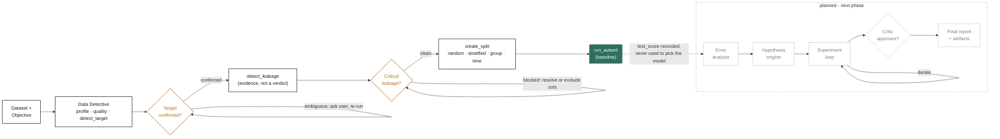
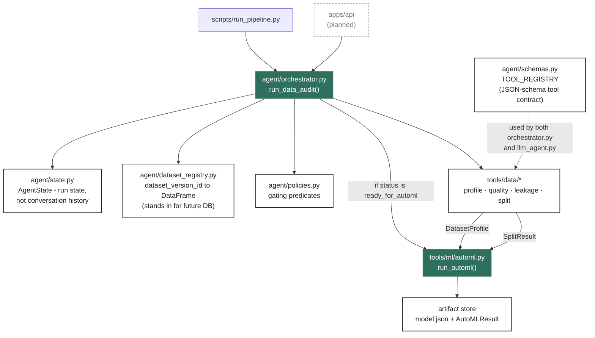
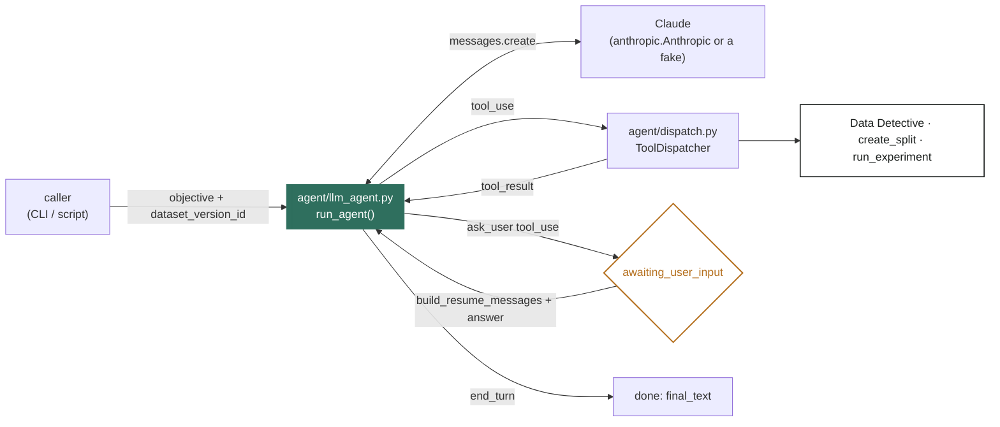

# AME pipeline: how it runs today

This documents the audit-to-baseline pipeline as actually built and tested — not the full
spec (see [spec.md](spec.md)), just what exists right now: `tools/data/*`, `tools/ml/automl.py`,
`tools/ml/errors.py`, `experiments/*`, `agent/*` (including the LLM-driven loop in
`agent/llm_agent.py`, backed by Claude or Gemini), and a minimal `apps/api` + `apps/web` running
it over HTTP. 217 passing tests back the claims below.

## Quickstart

Run it on any CSV. Most first passes pause — that's intentional, not a bug.

```bash
uv run python scripts/run_pipeline.py dataset/train.csv \
  --objective "predict mobile phone price range"
```

**Target gate.** If the target was ambiguous, the run exits with a ranked candidate list and a
reason for each score. Confirm it and re-run:

```bash
uv run python scripts/run_pipeline.py dataset/train.csv \
  --objective "predict mobile phone price range" \
  --target price_range
```

**Leakage gate.** If a critical leakage finding blocks the run, tell it which columns are
legitimately post-outcome (they get excluded and flagged), or force past it after reviewing:

```bash
uv run python scripts/run_pipeline.py dataset/titanic.csv \
  --objective "predict survival" --target survived \
  --post-outcome-columns boat,body
```

A clean run prints the winning model, its params, cross-validated and held-out test scores, and
where the winning model's metadata was saved (`data/artifacts/<experiment_id>/model.json`).

## Overall flow

Everything up to `run_automl` is built and tested today. Everything after the dashed arrow —
error analysis, hypotheses, the experiment loop, the critic — is the next phase, per
[spec.md](spec.md). The two diamonds are human-in-the-loop gates: neither the target column nor
a leakage-critical dataset gets silently decided, both pause the run and hand control back to
the caller.



## Module architecture

The orchestrator calls the Data Detective and AutoML tools directly as plain Python functions
today. `agent/schemas.py` already defines the JSON-schema contract an LLM would use to call the
same tools — it *mirrors* them, but nothing in the live call path goes through it yet.
`agent/dataset_registry.py` is the one module built purely as a placeholder: swapping it for the
Postgres `dataset_versions` table later changes no call site, only this one file.



This diagram covers the deterministic path (`agent/orchestrator.py`, a fixed profile -> target ->
leakage -> AutoML sequence). `agent/llm_agent.py` is a second, model-driven way to call the same
tools — see below.

## Agentic layer

`agent/llm_agent.py` replaces the orchestrator's fixed sequence with an actual LLM tool-calling
loop: the model sees the same `TOOL_REGISTRY` tools (plus `run_experiment`, and a synthetic
`ask_user` tool) and decides what to call, when to state a hypothesis, and when it needs a
human — instead of a hardcoded `if status == ...`. Nothing here makes a network call unless you
pass it a real client; every test drives the loop with a scripted fake
(`tests/unit/fake_anthropic.py`), so the control flow is proven without needing an API key.



`ask_user` always ends the current turn rather than being resolved inline — the same
re-entrant shape as `run_data_audit(confirmed_target=...)`, but the decision of *when* to ask is
the model's, not a hardcoded gate. `run_experiment`'s `hypothesis` field is required at the
schema level, so the model cannot call it without stating one (spec principle 3).

## Status

| Piece | State |
|---|---|
| `tools/data/*` — inspect, profile, quality, target detection, leakage, split | built & tested |
| `agent/*` — state, dataset registry, policies, orchestrator, tool-schema contract | built & tested |
| `tools/ml/automl.py` — baseline model search with structural test-set isolation | built & tested |
| `experiments/*` — experiment registry, parent/child graph, hypothesis-vs-parent conclusions | built & tested |
| `tools/ml/errors.py` — confusion matrix, per-class metrics, thresholds, subgroup performance, residuals | built & tested |
| `tools/validation/robustness.py` — CV variance, multi-seed, alternate-split, noise sensitivity | built & tested |
| `agent/llm_agent.py`, `dispatch.py`, `llm_tools.py` — LLM tool-calling loop, ask_user gate | built & tested |
| `agent/gemini_client.py` — Gemini via LiteLLM, same interface as `anthropic.Anthropic()` | built & tested |
| `apps/api/routes/agent.py` — HTTP API: upload dataset, start/answer/get a run | built & tested |
| `apps/web` — minimal Next.js page driving the API (upload, ask_user prompt, experiments table) | built |
| `scripts/fetch_dataset.py`, `scripts/run_pipeline.py`, `scripts/run_agent.py`, `ztest.py` | built |
| Fairness layer, calibration/drift checks, rule-based hypothesis engine, deterministic critic | planned (spec §11–12, §17–18) |
| DB persistence (replacing the in-memory dataset/experiment registries) | planned (spec §24) |
| Domain knowledge — plain `.md` files only, no RAG/vector store for now | scope decision |
